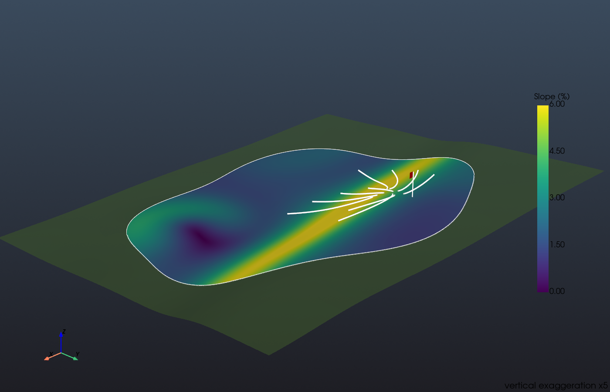
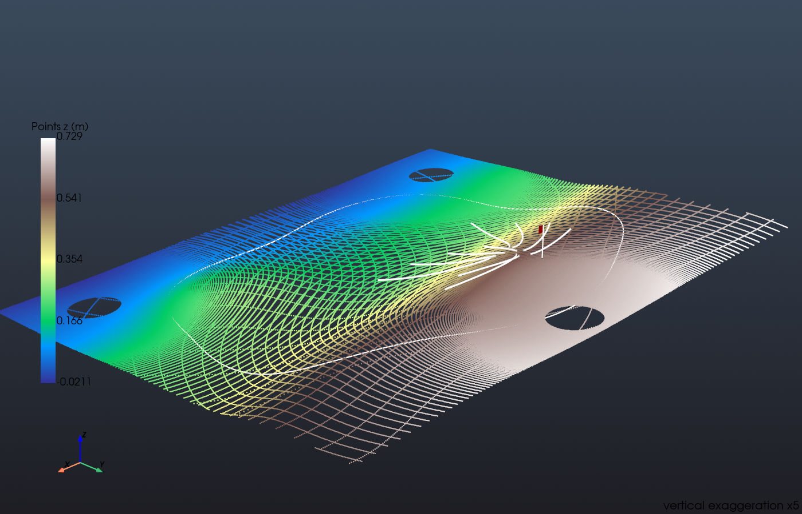

# Green Topography Simulator

A simulator for golf putting greens. It generates realistic green surfaces, rolls golf
balls across them with physically based putting dynamics, works out where a hole may
legally be cut, and simulates LIDAR scans of the green. Everything can be explored in an
interactive 3D view, either in a desktop window or in your browser.


*The putting surface coloured by slope (%), with ten putts rolled toward the hole.
Vertical scale exaggerated ×5.*


*The same green as seen by three simulated tripod LIDAR scanners: dense rings near each
tripod, sparse coverage far away, and shadowing behind the tier.*

## What it does

| Area | What it does |
|---|---|
| **Terrain** | Builds a green as a height map from simple layers: overall tilt, tiers, mounds, ridges and broad random swells. It also gives the green an irregular outline. The sample green is about 500 m², the size of an average US green. |
| **Ball physics** | Rolls a ball over the surface with constant rolling resistance set by the green speed (Stimpmeter reading) and a downhill pull of (5/7)·g·sinθ for a rolling ball. Each putt ends holed, stopped, or off the green. Checked against the Brede slope-correction formula used by agronomists. |
| **Green speed** | Converts between Stimpmeter readings and ball deceleration. Reports the *hold limit*, the steepest slope a ball can stop on at a given speed (7.9 % at stimp 10, 5.6 % at stimp 14). |
| **Hole locations** | Marks where a hole may be cut under USGA course set-up guidance: slope no more than 3 % within 3 ft of the hole, and at least 4 paces (12 ft) from any edge. |
| **LIDAR simulation** | *Terrestrial*: casts rays from tripod scanners, with range noise, occlusion and intensity. *Aerial*: an evenly spaced drone-style sweep. Point clouds export to `.las` (the LIDAR standard) or `.ply`. |
| **Reconstruction** | Turns any point cloud, simulated or real, back into a height map. This is the pipeline a real scan of a green would go through. |
| **Visualisation** | Interactive 3D view with layers you can toggle (surface, LIDAR points, putts), plus PNG rendering. |

The rules, construction standards, slope guidelines and physics behind these numbers are
documented with sources in [docs/golf-green-standards.md](docs/golf-green-standards.md).

## Running it

### Option 1: container (easiest, no Python needed)

Install [Podman](https://podman.io/docs/installation) (or Docker; the commands below work
with either). Then:

```sh
podman run --rm -p 8080:8080 ghcr.io/kshekar16/greentopographysimulator
```

Open **<http://localhost:8080>** once the log says `App running at`. The first run
downloads the image, about 1 GB. After that, building the scene takes about 15 seconds.
Use **New green** in the toolbar to generate a different green without restarting.

To save files, mount a folder at `/data`:

```sh
# Simulated LIDAR scan as a .las point cloud
podman run --rm -v ./data:/data ghcr.io/kshekar16/greentopographysimulator scan -o /data/scan.las

# Render the 3D view to an image
podman run --rm -v ./data:/data ghcr.io/kshekar16/greentopographysimulator render -o /data/green.png

# A different green, faster greens, drone scan
podman run --rm -p 8080:8080 ghcr.io/kshekar16/greentopographysimulator serve --host 0.0.0.0 --seed 3 --stimp 12 --scan aerial
```

On Windows PowerShell, write the mount as `-v ${PWD}/data:/data`.

The image works on Intel/AMD and ARM machines, including Apple Silicon Macs. To build it
yourself from a clone: `podman build -t greensim .` and then `podman run --rm -p 8080:8080 greensim`.

### Option 2: run locally with Python

Requires Python 3.11 or newer.

```sh
git clone https://github.com/kshekar16/GreenTopographySimulator.git
cd GreenTopographySimulator
python -m venv .venv
```

Activate the environment. On Windows run `.venv\Scripts\activate`, and on macOS/Linux run
`source .venv/bin/activate`. Then:

```sh
pip install -e ".[web,dev]"
greensim view            # desktop 3D window
```

## Commands

| Command | What it does |
|---|---|
| `greensim view` | Opens a desktop 3D window (needs a display). |
| `greensim serve` | Serves the 3D viewer at <http://localhost:8080>. Add `--open` to launch the browser, `--port N` to change the port, or `--host 0.0.0.0` to accept outside connections (the container does this). |
| `greensim render -o FILE.png` | Renders the 3D view to an image without opening a window. |
| `greensim scan -o FILE.las` | Writes the simulated LIDAR point cloud (`.las` or `.ply`). |

Options for every command:

| Option | Default | Meaning |
|---|---|---|
| `--seed N` | `0` | Which green to generate, 0–99999, or `random`. Each seed gives a different outline and undulations, and the same seed always gives the same green. |
| `--stimp FT` | `10` | Green speed in feet. About 8 is slow, 10 medium, 12 fast, and 13 or more tournament. |
| `--scan TYPE` | `terrestrial` | `terrestrial` (three tripod scanners), `aerial` (drone), or `none`. |

The `view`, `serve` and `render` commands also take `--exaggeration X` (vertical scale,
default 5) and `--hide surface points putts` (layers to start hidden).

### Using the 3D view

- **Rotate:** left-drag.
- **Pan:** Shift + drag, or middle-drag.
- **Zoom:** scroll wheel.
- **Layers:** checkboxes toggle the **surface** (coloured by slope), the **LIDAR points**
  (coloured by elevation), and the **putts**. Gold putts were holed, white putts stopped,
  and red putts ran off the green.
- **New greens:** in the browser, the toolbar has a **Seed** and a **Stimp** box.
  **Generate** rebuilds the scene from them (or press Enter in either box), and
  **New green** picks a random seed. The summary above the view updates to match.
  In the desktop window, press `n` for a new random green.
- **Desktop window only:** `r` resets the camera and `q` quits.

### What gets printed

Each run prints a summary of the generated scene, for example:

```
Green #0: 507 m^2, slope mean 2.8%, p90 5.5%, max 6.6%; 66% at <=3%; 0.0% too steep to hold at stimp 10 (> 7.9%)
Valid pin area: 119 m^2
Hole at (13.00, 21.50)
10 putts in 0.12s, 0 holed (aimed straight, no break read)
terrestrial scan: 546,190 points in 11.4s; on-green coverage 57% of 10 cm cells; reconstruction RMSE 0.7 mm
```

The demo putts are aimed straight at the hole on purpose, with no allowance for break, so
the paths show how the slopes curve the ball.

### Opening the point clouds

`.las` files open in free tools such as [CloudCompare](https://www.cloudcompare.org/) and
[QGIS](https://qgis.org/), and in most GIS or survey software. Coordinates are in metres,
in a local frame with the origin at the corner of the scanned area. Each point carries an
intensity value and a scanner ID.

## Using it as a library

```python
from greensim.terrain.generators import build, tilt, tier, mound
from greensim.terrain import GreenBoundary
from greensim import Hole, roll_ball
from greensim.physics.ball import velocity_toward
from greensim.analysis import valid_pin_mask, slope_stats

green = build(30, 25, 0.05, [tilt(1.5, 270), tier(0.2, (15, 14), 90, 5.0), mound((22, 8), 0.1, 6)])
outline = GreenBoundary.ellipse(15, 12.5, 12, 10)

print(slope_stats(green, outline, stimp_ft=11))
hole = Hole(12.0, 16.0)
putt = roll_ball(green, (15, 8), velocity_toward((15, 8), (12, 16), 2.4), stimp_ft=11, hole=hole, boundary=outline)
print(putt.outcome, putt.final_position)
```

Units are metres and seconds throughout. The one exception is green speed, which is
given as the Stimpmeter reading in feet.

## Limitations

- **Pure rolling only.** The skid phase in the first 10–20 % of a putt is not modelled yet.
- **Placeholder hole capture.** The rule for when a ball drops in is a placeholder until it
  is checked against published capture-speed data.
- **No grain, wind or moisture.** Green speed is uniform and the same in every direction.
- **Fringe not modelled.** A ball that leaves the putting surface simply stops.
- **Single-viewer web app.** `serve` is meant for one person at a time.

## Project layout

| Path | Contents |
|---|---|
| `src/greensim/cli.py` | The `greensim` command |
| `src/greensim/scene.py` | Builds the demo scene (green, hole, putts, scan) from a seed |
| `src/greensim/constants.py` | Rules of Golf values, physical constants, defaults |
| `src/greensim/terrain/` | Height field, green outline, procedural generators |
| `src/greensim/physics/` | Stimpmeter relations, ball-roll integrator, hole |
| `src/greensim/analysis/` | Slope statistics, hold limit, valid hole locations |
| `src/greensim/lidar/` | Scan simulation, point cloud → height field, LAS/PLY I/O |
| `src/greensim/viz/` | Desktop 3D view, browser viewer, 2D plan plots |
| `docs/golf-green-standards.md` | Research notes: rules, standards, physics, sources |
| `tests/` | Test suite (`pytest`) |
| `Containerfile` | Container image definition |
| `.github/workflows/container.yml` | CI: tests, builds and smoke-tests the image, publishes it to GHCR |

## Development

```sh
pip install -e ".[web,dev]"
pytest                         # full test suite
pytest tests/test_physics.py   # one file
```

Every push to `main` runs the tests and builds the container on GitHub Actions. The
image is smoke-tested and published to `ghcr.io/kshekar16/greentopographysimulator`
(tags: `latest`, the short commit SHA, and the version for `v*` tags).
